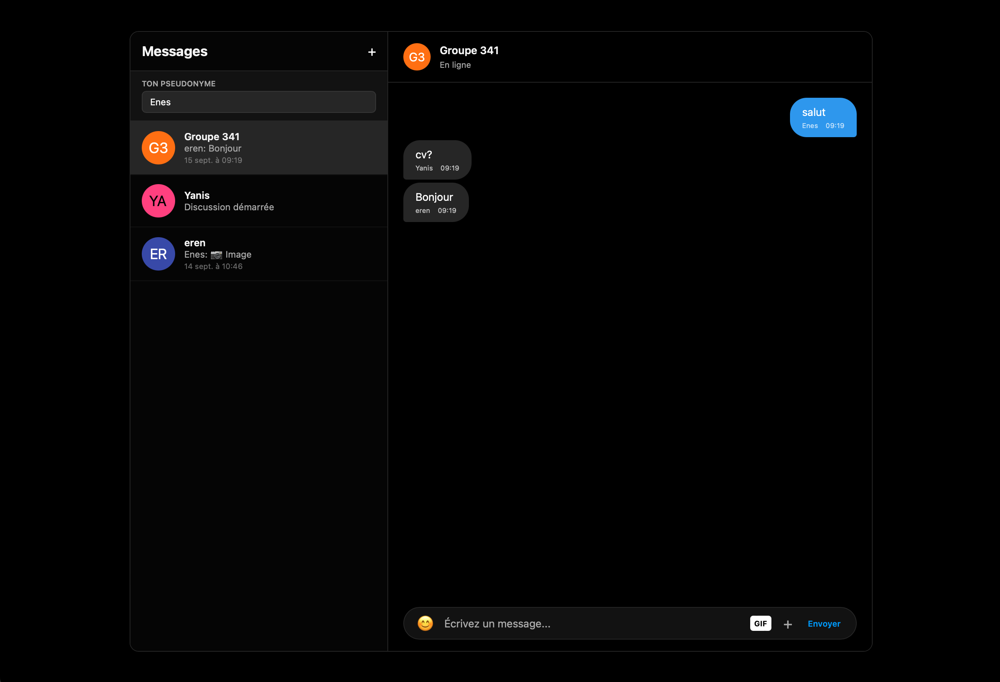

# Guide d'installation et de contribution — Documentation LifeInvader

Ce guide explique comment récupérer, installer et lancer la documentation
Docusaurus du projet **LifeInvader**, puis comment y
ajouter ou modifier des pages.

La documentation vit sur la branche **`docs`**, séparée du code. La branche
`front-end` (et les autres) ne contient plus aucun fichier de documentation :
c'est volontaire, pour éviter les conflits entre le code et les documents.

---

## 1. Ce que contient la branche `docs`

```
documentation/
├── docs/                  # 48 pages Markdown, une par sujet
│   ├── intro.md
│   ├── demarrage/         # 3 pages  — prérequis, lancement, Apache
│   ├── architecture/      # 4 pages  — vue d'ensemble, routeur, arborescence, conventions
│   ├── developpement/     # 5 pages  — api.js, vues, composants, CSS, messagerie
│   ├── reference/         # 4 pages  — endpoints API, messagerie, socket, localStorage
│   ├── exploitation/      # 2 pages  — tests, dépannage
│   ├── historique/        # 2 pages  — versions, décisions techniques
│   ├── installation/      # 6 pages  — installation par composant
│   ├── technique/         # 9 pages  — architecture, API, schéma, sécurité, websockets
│   ├── utilisateur/       # 7 pages  — guide utilisateur
│   ├── database_user/     # 1 page   — documentation de la base
│   └── gestion-projet/    # 4 pages  — Scrum, Trello, Git, usage de l'IA
├── sidebars.js            # navigation : 48 entrées
├── docusaurus.config.js   # configuration du site
├── package.json           # dépendances et scripts
├── package-lock.json
├── src/                   # page d'accueil + thème aux couleurs du projet
├── static/img/favicon.ico
├── README.md
└── GUIDE-INSTALLATION.md  # ce guide
```

Deux points à retenir sur la configuration :

- **`routeBasePath: '/docs'`** : la page d'accueil occupe `/`, la documentation
  est servie sous `/docs/...`. C'est ce qui rend valides les liens des boutons
  de la page d'accueil.
- **La navigation est manuelle** : `sidebars.js` liste explicitement les pages.
  Une page absente de ce fichier est bien générée, mais reste introuvable dans
  le menu.

---

## 2. Prérequis : Node.js dans WSL

Node.js doit être installé **dans WSL**, pas la version Windows. La méthode la
plus simple reste nvm :

```bash
# Installer nvm
curl -o- https://raw.githubusercontent.com/nvm-sh/nvm/v0.40.1/install.sh | bash

# Recharger le shell
source ~/.bashrc

# Installer Node.js 22 (ou 20 LTS minimum)
nvm install 22

# Vérifier
which npm
# Attendu : /home/VOTRE_USER/.nvm/versions/node/v22.x.x/bin/npm
# Si vous voyez /mnt/c/... → c'est le npm Windows, il ne fonctionnera pas
```

Vérification rapide de la version :

```bash
node -v      # v20.x ou v22.x
npm -v
```

---

## 3. Récupérer la documentation

### Cas simple : vous n'avez pas encore cloné le dépôt

```bash
git clone https://github.com/Guillaume-8/SAE-Gestion_Projet-Instagram.git
cd SAE-Gestion_Projet-Instagram
git checkout docs
```

### Vous travaillez déjà sur une autre branche

Changer de branche **retire** les fichiers de l'autre branche de votre dossier
de travail. Pour garder les deux côte à côte, utilisez un worktree :

```bash
cd ~/sae502-instagram          # votre clone existant
git fetch origin
git worktree add ../sae502-docs docs
cd ../sae502-docs/documentation
```

Sinon, la méthode classique reste valable :

```bash
cd ~/sae502-instagram
git fetch origin
git checkout docs
git pull origin docs
```

> Après un `git checkout docs`, les dossiers `frontend/` et
> `backend-messagerie/` disparaissent : ils appartiennent aux autres branches.
> C'est normal, la branche `docs` ne contient que la documentation.

---

## 4. Installer et lancer

```bash
cd documentation

# Première fois uniquement (ou après une mise à jour de package.json)
npm install

# Serveur de développement avec rechargement automatique
npm run start
```

Le site est accessible sur **http://localhost:3000** :

- page d'accueil : `http://localhost:3000/`
- documentation : `http://localhost:3000/docs`

Alternative reproductible (utilise exactement les versions du
`package-lock.json`) :

```bash
npm ci
npm run start
```

> **Attention** : si vous obtenez l'erreur `CMD.EXE a été démarré avec le chemin
> UNC`, votre terminal VS Code est en mode Windows. Ouvrez un terminal WSL :
> `Ctrl+Shift+P` → `Terminal: Select Default Profile` → choisir **WSL Bash** ou
> **Debian**.

> **Attention** : si vous obtenez `docusaurus: Permission denied`, supprimez
> `node_modules` et réinstallez :
> ```bash
> rm -rf node_modules
> npm install
> npm run start
> ```

---

## 5. Ajouter une page

1. **Créer le fichier** dans la section qui convient :
   `docs/<section>/ma-page.md`

2. **Ajouter l'en-tête** (front matter) et un titre unique :

   ```markdown
   ---
   sidebar_position: 3
   ---

   # Titre de ma page

   Mon contenu en Markdown…
   ```

3. **Déclarer la page dans `sidebars.js`** — étape obligatoire :

   ```js
   {
     type: 'category',
     label: 'Front-end — Démarrage',
     items: [
       'demarrage/prerequis',
       'demarrage/lancement',
       'demarrage/ma-page',      // ← l'identifiant = chemin sans .md
     ],
   },
   ```

4. **Sauvegarder** : si `npm run start` tourne, le site se reconstruit seul.

5. **Vérifier** que la page apparaît dans le menu et que le lien fonctionne.

### Liens entre pages

Les liens sont **relatifs au fichier** :

```markdown
Voir [le dépannage](../exploitation/depannage.md).
Voir [la messagerie](./messagerie.md).
```

N'utilisez pas de chemins absolus en `/docs/...` dans les pages : ils cassent
dès que la configuration change.

### Images

Placez l'image à côté du fichier Markdown (ou dans un sous-dossier `images/`)
et référencez-la en relatif :

```markdown

```

---

## 6. Règles de rédaction (MDX)

Les pages sont compilées en **MDX** : du Markdown enrichi de JSX.

| À faire | À éviter |
| --- | --- |
| Un seul titre `#` par page | Plusieurs `#` (le second écrase le titre) |
| `{/* commentaire */}` | `<!-- commentaire -->` (invalide en MDX) |
| `style={{color: 'red'}}` dans une balise | `style="color: red"` |
| `colSpan="2"` | `colspan="2"` (minuscules) |
| Blocs de code avec langage (` ```bash `) | Blocs sans langage (pas de coloration) |
| Guillemets doubles dans les textes français | Apostrophes non échappées dans du code JS |

Les tableaux HTML avec styles JSX fonctionnent (voir
`docs/utilisateur/messagerie.md`), mais restent à réserver aux mises en page
particulières : un tableau Markdown suffit dans la plupart des cas.

---

## 7. Construire la version statique

```bash
cd documentation
npm run build      # génère documentation/build/
npm run serve      # prévisualise le résultat sur http://localhost:3000
```

`build/` peut ensuite être déposé sur n'importe quel hébergeur statique, ou
servi par Apache :

```apacheconf
<VirtualHost *:443>
    ServerName docs.lifeinvader.local
    DocumentRoot /home/eren/sae502-instagram/documentation/build

    <Directory /home/eren/sae502-instagram/documentation/build>
        Options FollowSymLinks
        AllowOverride All
        Require all granted
    </Directory>
</VirtualHost>
```

Avec `routeBasePath: '/docs'`, les URL servies sont `/docs/...`. Si le site est
déployé dans un sous-dossier, ajustez `baseUrl` dans `docusaurus.config.js`
(par exemple `baseUrl: '/documentation/'`).

---

## 8. Avant de commiter

- [ ] La page est déclarée dans `sidebars.js` et apparaît dans le menu
- [ ] Les liens internes pointent vers des fichiers existants
- [ ] Les images s'affichent
- [ ] `npm run build` passe sans erreur
- [ ] Aucun fichier `node_modules/`, `build/` ou `.docusaurus/` dans le diff
- [ ] Le message de commit décrit la partie rédigée

```bash
git status
git add documentation/
git commit -m "docs: mise à jour du guide d'installation"
git push origin docs
```

### Fichiers à ne jamais commiter

Le `.gitignore` de la branche les exclut déjà :

```gitignore
node_modules/
build/
.docusaurus/
.env
*.log
.DS_Store
*:Zone.Identifier
certs/
```

Si `.docusaurus/` a déjà été suivi par git (cache de build), retirez-le de
l'index :

```bash
git rm -r --cached documentation/.docusaurus
git commit -m "chore: retire le cache Docusaurus du dépôt"
```

---

## 9. Problèmes fréquents

| Problème | Cause | Solution |
| --- | --- | --- |
| `CMD.EXE` / chemin UNC | Terminal VS Code en mode Windows | Utiliser un terminal WSL |
| `npm` pointe vers `/mnt/c/...` | Node.js Windows au lieu de WSL | Installer Node avec nvm (étape 2) |
| `docusaurus: Permission denied` | `node_modules` corrompu | `rm -rf node_modules && npm install` |
| `Could not read package.json` | Mauvais dossier | Se placer dans `documentation/` |
| Page blanche sur `localhost:3000` | Erreur au démarrage | Lire la sortie de `npm run start` |
| Page invisible dans le menu | Absente de `sidebars.js` | Ajouter son identifiant dans la catégorie |
| `Doc with id "x" not found` | Identifiant erroné dans `sidebars.js` | L'identifiant est le chemin du fichier sans `.md` |
| Toutes les pages « introuvables » | Dossier renommé `Docs` (majuscule) | Le dossier doit s'appeler `docs` (minuscules) |
| Conflit de route à `/` | `routeBasePath: '/'` + `src/pages/index.js` | Garder `routeBasePath: '/docs'` |
| Liens de l'accueil morts | `routeBasePath` modifié | Remettre `'/docs'` dans `docusaurus.config.js` |
| Changements non visibles | Cache ou serveur arrêté | `Ctrl+C` puis `npm run start` ; `Ctrl+Shift+R` dans le navigateur |
| `Zone.Identifier` dans le dépôt | Téléchargement depuis Windows | `find . -name "*:Zone.Identifier" -delete` |
| Erreur MDX `Unexpected character` | Balise HTML mal formée | Vérifier les attributs (`colSpan`, `style={{…}}`) |

---

## 10. Répartition des pages

Toutes les pages listées ci-dessous sont désormais rédigées. La colonne
« responsable » sert de référence pour les corrections et les mises à jour.

| Membre(s) | Pages |
| --- | --- |
| **Eren** | `demarrage/*`, `architecture/*`, `developpement/*`, `reference/*`, `exploitation/*`, `historique/*`, `installation/front-end.md`, `technique/front-end.md`, `technique/apache-config.md`, `utilisateur/inscription-connexion.md`, `utilisateur/publications.md`, `utilisateur/interactions.md` |
| **Mathias** | `installation/back-end.md`, `technique/back-end.md`, `technique/api-reference.md`, `technique/database-schema.md` |
| **Thomas** | `installation/database.md` (partie utilisateurs), `technique/database-schema.md` |
| **Pierre / Mathias** | `installation/database.md` (partie photos/vidéos), `database_user/documentation-db.md` |
| **Guillaume** | `installation/ssl.md`, `technique/securite.md` |
| **Yanis / Enes** | `utilisateur/messagerie.md`, `technique/websockets.md`, `technique/tests.md` |
| **Tanguy / Jonathan** | `utilisateur/filtres.md` |
| **Mathéo** | `utilisateur/signalement.md` |
| **Yanis** | `gestion-projet/scrum.md`, `gestion-projet/trello.md`, `gestion-projet/git.md`, `gestion-projet/ia-usage.md` |

---

## 11. Résumé des commandes

```bash
# --- Installation (une seule fois) ---
curl -o- https://raw.githubusercontent.com/nvm-sh/nvm/v0.40.1/install.sh | bash
source ~/.bashrc
nvm install 22

# --- Récupérer la branche docs ---
cd ~/sae502-instagram
git fetch origin
git checkout docs
git pull origin docs
cd documentation

# --- Installer et lancer ---
npm install
npm run start                 # → http://localhost:3000/docs

# --- Construire la version statique ---
npm run build
npm run serve

# --- Publier ses modifications ---
git status
git add documentation/
git commit -m "docs: description courte"
git push origin docs
```

---

## 12. En cas de doute

1. `npm run build` : il affiche les liens cassés et les identifiants de sidebar
   inexistants.
2. Le fichier `sidebars.js` est la source de vérité de la navigation.
3. La page `exploitation/depannage.md` de la documentation détaille les
   problèmes côté application (et non côté site de documentation).
