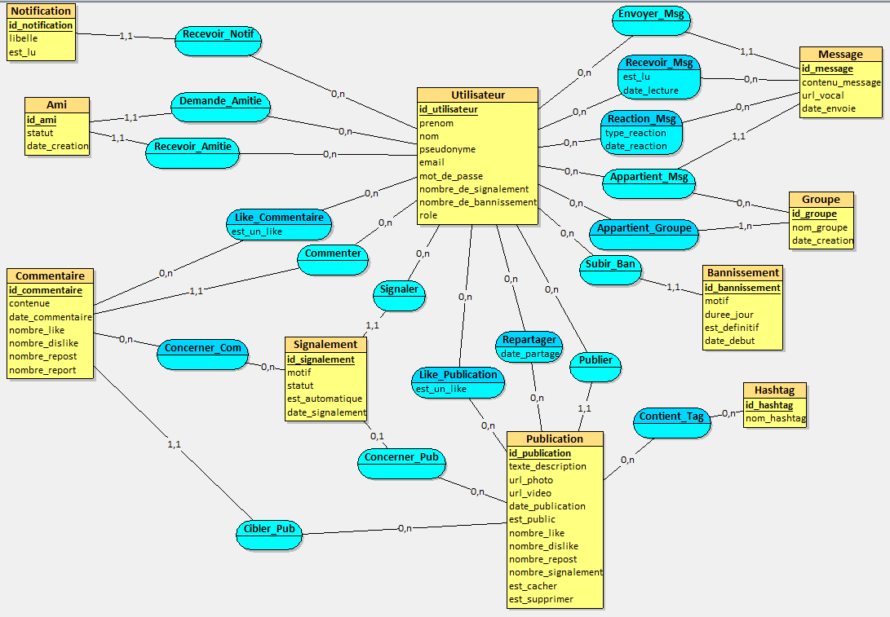

# Schéma des bases de données

:::note Page à rédiger
**Responsables** : Thomas, Pierre, Mathias
:::

## 1. Modèle Conceptuel de Données (MCD)

Voici la structure de la base de données gérant les publications, les médias, la modération et les interactions de LifeInvader :

---

## 2. Dictionnaire de Données (Tables Principales)

| Table | Champ | Type | Description / Contrainte |
|---|---|---|---|
| **Publication** | `url_photo` / `url_video` | `TEXT` | Stocke le lien du média généré avec UUID |
| **Publication** | `est_cacher` | `BOOLEAN` | Masqué par la modération (`0` ou `1`) |
| **Publication** | `est_supprimer` | `BOOLEAN` | Soft-delete pour traçabilité (`0` ou `1`) |
| **Commentaire** | `nombre_report` | `INT` | Nombre de signalements du commentaire |
| **Signalement** | `est_automatique` | `BOOLEAN` | `1` si généré par l'IA, `0` si humain |

---

## 3. Choix d'Architecture et Sécurité (BUT RT)

### Stockage des Médias et Anti-IDOR
- Les images, vidéos et vocaux ne sont pas stockés avec leurs noms d'origine ni avec un ID séquentiel.
- Le backend génère un **UUID v4** lors de l'upload et enregistre l'URL complète dans la BDD (`url_photo`, `url_video`, `url_vocal`).
- **Justification :** Empêche l'écrasement de fichiers en cas de doublons et bloque l'énumération de fichiers (faille IDOR).

### Gestion des Signalements de Commentaires (`Concerner_Com`)
- Les signalements de publications pointent directement vers `Publication`.
- Pour les commentaires, la table de liaison `Concerner_Com` relie `Signalement` et `Commentaire` afin de conserver une structure de modération modulable.

### Modèle de Messagerie par Groupes (`Groupe` & `Message`)
- Tous les messages sont rattachés à un `id_groupe`.
- Une conversation privée entre deux utilisateurs est traitée comme un groupe restreint à 2 membres (`Appartient_Groupe`), ce qui simplifie l'évolution vers des salons de groupe.

### Soft-Delete (Suppression Logique)
- Aucune publication signalée ou supprimée par l'utilisateur ne subit un `DELETE` physique immédiat.
- Le champ `est_supprimer` repasse à `1` afin d'assurer la conservation des logs d'audit et la traçabilité.
